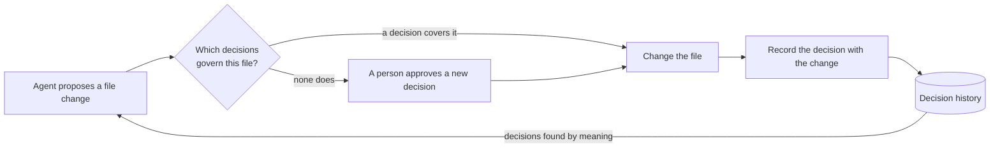

# Decision Version Control: What AI Coding Agents Need Beyond Memory

*An idea note by Himanshu Kumar*

---

## The problem

An AI coding agent does not remember **why** the code is the way it is.

Suppose a team decided that a payments client retries only idempotent calls, because retrying a charge can charge a customer twice. Weeks later, an agent is asked to fix a timeout. It adds a retry to every call. The code compiles, the tests pass, and the decision is gone. Nothing recorded that it was ever made, so nothing noticed that it was broken.

## Why memory is not enough

The common answer is to give the agent memory: a rules file (such as `CLAUDE.md` or `.cursorrules`) or a vector store of past notes. Memory helps an agent **recall text**. A team needs four more things:

| | Rules file / vector memory | Decision version control |
|---|---|---|
| Knows which files a decision governs | No | Yes: each decision names the files it affects |
| Keeps the history of a decision | No: the text is edited in place | Yes: each decision is versioned |
| Sees that a new decision contradicts an old one | No | Yes: decisions are checked against each other |
| Stops a change | No: it only adds text to a prompt | Yes: a gate sits in front of every write |

The core difference: memory is **advice** the agent may ignore. A decision record is **a rule the system enforces**.

## The idea: version decisions like code

Treat a design decision as a first-class record, kept beside the code it governs.

1. **A decision is a record.** It has a summary, a rationale, and the files it governs.
2. **It is versioned.** A changed decision is a new version, so the history of *why* is never lost.
3. **Every write is tied to a decision.** Before an agent changes a file, the system checks which decisions govern that file. A change with no decision behind it is not silent: it creates a new decision that a person can approve.
4. **Contradictions are caught early.** A new decision is compared with the existing ones that touch the same files, so a conflict is visible before the code changes.
5. **Decisions are found by meaning.** An agent searches the decisions that govern a file by what they mean, not only by the exact words.

## Why this matters more as agents write more code

When people write most of the code, decisions live in their heads and in reviews. When agents write most of the code, the reasons must live in the system itself, or they disappear with every new session. Version control made **changes** traceable. Decision version control makes **reasons** traceable, and lets the system enforce them.

## Takeaway

Do not stop at giving AI agents a memory. Give them decisions that are versioned, linked to the files they govern, checked against each other, and enforced at the moment of change.

---

Himanshu Kumar · [linkedin.com/in/himakumar](https://linkedin.com/in/himakumar)
